<!-- NOC profile // signal over noise -->

  

  
  
  
  

## // OPERATOR NOTE

Most of my projects begin with some version of **“why is this behaving like that?”**

I like the boundary where software meets reality: sensors lie, clocks drift, networks drop packets, desktops race themselves, and models miss their latency budget. I instrument the weird parts, find the actual bottleneck, and make the recovery path boring.

Right now I am finishing an M.S. in Electrical & Computer Engineering at Clarkson University and building across robotics, native Linux, edge AI, and inference systems.

> **I make Linux behave, robots coordinate, and models fit inside real constraints.**

## // PERFORMANCE RACK

These are measured results from systems I built—not decorative percentages.

| **ROS 2 STACK** | **VISION PATH** | **CPU FACE AUTH** | **AUDIO PIPELINE** |
|:---:|:---:|:---:|:---:|
| **61** automated tests | **9.02 ms** p95 inference | **10.1 ms** p50 embeddings | **41,265** recordings |
| 5 coordinated packages | 100% valid detections after debugging | C++17 + ONNX Runtime | STFT + MFCC + Parquet |

## // SYSTEMS ON THE BENCH

### [Nocturne for Hyprland](https://github.com/justneeraj12/nocturne-hyprland) · daily driver turned control plane

Qt 6, Wayland, and D-Bus desktop infrastructure built around zero-idle UI, deterministic recovery, and the idea that a Linux environment should feel like one coherent machine—not twelve scripts in a trench coat.

### [ROS 2 Vision Leader–Follower](https://github.com/justneeraj12/ee616-vision-leader-follower) · simulation

A five-package warehouse coordination stack with perception, stamped messages, diagnostics, automated tests, and performance measurements. The interesting work was not making the demo move; it was finding color-space and stale-timestamp failures and proving the fixes.

### [Face Unlock for Linux](https://github.com/justneeraj12/face-unlock-linux) · native security path

A CPU-only C++17 authentication pipeline connecting PAM, a long-running daemon, UNIX sockets, and ONNX YuNet/SFace inference. Small latency budgets, explicit boundaries, no cloud dependency.

### [Cross-Lingual Speech Emotion Recognition](https://github.com/justneeraj12/cross-lingual-speech-emotion-recognition) · data before demos

A reproducible audio pipeline for 41,265 CAMEO recordings. The work is in the unglamorous parts that decide whether ML results mean anything: transforms, schemas, data validation, and repeatable preprocessing.

<strong>Origin story: the physical build</strong>

 

Before the larger systems, I built a <a href="https://github.com/justneeraj12/tello_guesture_control">hand-gesture controller for a DJI Tello</a>. Watching a real drone respond to noisy vision input is what made me care about the gap between “the code runs” and “the system works.”

## // LIVE TELEMETRY

  
  

  

## // TOOLCHAIN

<pre>
CONTROL      C++17 · Python · C · ROS 2 · OpenCV · Gazebo
INFERENCE    ONNX Runtime · PyTorch · NumPy · pandas · signal processing
SYSTEMS      Linux · Qt 6 · Wayland · D-Bus · PAM · UNIX sockets
DELIVERY     CMake · Docker · GitHub Actions · pytest · Git
</pre>

## // OPERATING RULES

<pre>
01  Profile before optimizing.
02  Make failure observable.
03  Test the boundary, not only the happy path.
04  A recovery path is part of the feature.
05  If the metric is not reproducible, it is decoration.
</pre>

M.S. ECE @ Clarkson · B.E. AI & ML · former IEEE RAS Chapter Chair + Robotics Club President

<code>NOC // BUILD QUIETLY · MEASURE HONESTLY · SHIP THE SYSTEM</code>

